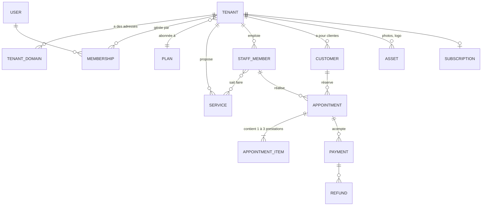

# Horaneo : proposition de structure de la base de données (V1)

> **Validé le 4 octobre 2026**, avec toutes les propositions de la section 6. Mis en place à l'étape 1 (`src/db/schema/`, `drizzle/`).

## 1. Principes généraux

| Sujet | Choix proposé | Pourquoi |
|---|---|---|
| Base | PostgreSQL 16 sur le VPS (Coolify), jamais exposée à Internet | Demandé dans le brief |
| Identifiants | UUID (version 7, triables par date) | Impossibles à deviner, pas de « client n° 12 » visible |
| Dates | `timestamptz`, toujours enregistrées en heure universelle (UTC) | Affichées ensuite dans le fuseau du tenant |
| Horaires d'ouverture | Heure locale (`09:00`) + jour de la semaine | Un horaire « 9 h » reste 9 h après le changement d'heure |
| Montants | Nombre entier en centimes + devise (`EUR`) | Pas d'erreur d'arrondi |
| Téléphones | Format international E.164 (`+33612345678`) | Demandé dans le brief |
| Textes traduisibles | Champ JSON par langue : `{"fr": "Soin visage", "en": "Facial"}` | Ajouter une langue ne demande aucune modification de la base |
| Isolation | Colonne `tenant_id` sur **toutes** les tables métier + règles d'accès par ligne (RLS) | Voir section 3 |

**En résumé :** chaque professionnel est un « tenant ». Toutes ses données (prestations, rendez-vous, clientes, photos…) portent son identifiant, et PostgreSQL lui-même refuse de montrer les lignes d'un autre tenant.

## 2. Vue d'ensemble

Les tables sont rangées en 8 familles.

---

## 3. Isolation des données (le point critique)

1. L'application se connecte à PostgreSQL avec un rôle **sans privilège** (`app_user`). Il n'est pas propriétaire des tables et ne peut pas contourner les règles.
2. Pour chaque requête, le serveur lit le nom de domaine, trouve le tenant, puis ouvre une transaction et déclare : `SET LOCAL app.tenant_id = '…'`.
3. Chaque table métier porte une règle : *« ne montrer et n'accepter que les lignes dont `tenant_id` = `app.tenant_id` »*. Sans tenant déclaré, la base ne renvoie **rien**.
4. L'espace admin utilise un second rôle (`app_admin`) qui voit tous les tenants. Ce rôle n'est disponible que dans le code de l'espace admin, et chacune de ses actions est enregistrée dans le journal (`audit_log`).
5. Des tests automatiques créent deux tenants, A et B, et vérifient que A ne peut ni lire, ni modifier, ni supprimer, ni créer une donnée de B, sur **chaque** table.

---

## 4. Les tables

### Famille A : plateforme et configuration (hors tenant)

**`platform_settings`** : réglages généraux, modifiables depuis l'admin, sous forme clé → valeur.
Exemples : `product_name = "Horaneo"`, `main_domain = "horaneo.com"`, `prices_display = "TTC"`, `commitment_months = 12`, `setup_fee_cents = 0`, `go_live_delay_days = 5`, `deposit_commission_rate = 0`, `retention_days_after_cancel = 30`.

**`plans`** : les packs.
| Colonne | Exemple |
|---|---|
| `code` | `basic`, `essentiel`, `serenite` |
| `name` (traduisible) | `{"fr": "Sérénité"}` |
| `price_cents`, `currency`, `interval` | `6900`, `EUR`, `month` |
| `stripe_price_id` | lien avec Stripe Billing |
| `limits` (JSON) | `{"online_bookings_per_month": 5, "members": 1, "photos": 5, "services": 10, "sms_per_month": 0}` (vide = illimité) |
| `features` (JSON) | `{"full_site": false, "custom_domain": false, "online_payment": false, "promo_codes": false, "stats": false, "branding_footer": true}` |
| `is_public`, `sort_order` | affichage sur le site commercial |

Les limites et fonctions sont dans des champs JSON : ajouter une fonction en V2 (cartes cadeaux, IA…) ne demandera pas de modifier la base.

**`legal_documents`** : mentions légales, confidentialité et conditions du SaaS, par langue et par version.

### Famille B : comptes et connexion

**`users`** : toute personne qui se connecte (gérante ou administratrice). Les clientes finales n'en ont **jamais**.
`email` (unique), `name`, `image`, `locale`, `is_platform_admin`, `two_factor_enabled`, `last_login_at`.

**`auth_accounts`** : liens avec Google ou Apple (un utilisateur peut en avoir plusieurs).
**`auth_sessions`** : sessions ouvertes.
**`auth_verification_tokens`** : liens magiques envoyés par e-mail (usage unique, durée courte).
**`auth_two_factor`** : secret de double vérification de l'administratrice (chiffré) et codes de secours.

**`memberships`** : qui gère quel tenant. `user_id`, `tenant_id`, `role` (`owner` pour la gérante ; d'autres rôles possibles plus tard).
Une même personne peut ainsi gérer plusieurs établissements.

### Famille C : le tenant

**`tenants`**
| Colonne | Rôle |
|---|---|
| `slug` | `institut-lea` → `institut-lea.horaneo.com` (mots réservés interdits : www, admin, api, app…) |
| `name` | nom du site (enseigne) |
| `status` | `draft` (en création), `active`, `suspended`, `cancelled` (période de 30 jours), `deleted` |
| `plan_id` | pack actuel |
| `country`, `default_locale`, `enabled_locales`, `currency`, `timezone` | international : `FR`, `fr`, `{fr}`, `EUR`, `Europe/Paris` |
| `phone`, `email`, `address_*`, `latitude`, `longitude` | infos pratiques |
| `business_category` | texte de configuration (`beaute`, `coiffure`…), **jamais** utilisé dans une règle `si … alors` |
| `template_key`, `theme` | `wellness`, et `light` / `dark` / `nature` |
| `brand` (JSON) | logo, couleurs (`primary`, `secondary`, `accent`…) |
| `activated_at`, `cancelled_at`, `deletion_scheduled_at` | cycle de vie |

**`tenant_domains`** : adresses du site.
`hostname` (unique : `institut-lea.horaneo.com` ou `www.institut-lea.fr`), `type` (`subdomain` / `custom`), `is_primary`, `status` (`pending`, `active`, `error`), `cloudflare_hostname_id`, `ssl_status`, `verified_at`.

**`businesses`** (migration 0012) : entreprises d'un site (une le plus souvent ; deux indépendantes dans un même institut en ont deux).
`name` (nom affiché, ex. prénom), `legal_name`, `siret`, `vat_number`, `email`, `phone`, `address_line1`, `postal_code`, `city`, `stripe_account_id` (unique), `stripe_charges_enabled`, `slug` (adresse de sa page, unique dans le site), `profile` (JSON : titre, métier, présentation, disponibilités, photo), `is_primary` (une seule par site : elle règle l'abonnement), `sort_order`.
Les tables d'une entreprise (prestations, équipe, horaires, indisponibilités, clientes, rendez-vous, paiements, remboursements, codes promo, gérantes, messages) portent un `business_id`, avec une clé étrangère `(tenant_id, business_id)` qui empêche de mélanger deux sites. Les clientes, rendez-vous et paiements ne sont visibles que de leur entreprise.

**`business_settings`** (ancienne `tenant_settings`) : règles de réservation et préférences (une ligne par entreprise, valeurs par défaut du brief).
| Colonne | Défaut |
|---|---|
| `min_notice_minutes` | 120 (2 h) |
| `max_advance_days` | 60 |
| `slot_interval_minutes` | 15 |
| `max_services_per_booking` | 3 |
| `cancellation_deadline_hours` | 24 |
| `deposit_enabled` / `deposit_type` / `deposit_value` | non / `percent` / 30 |
| `hold_minutes` | 10 |
| `daily_summary_enabled`, `monthly_summary_enabled` | oui / oui |

**`redirects`** : anciennes adresses du site du client → nouvelles (`from_path`, `to_path`, code 301).

### Famille D : contenus du site

**`site_pages`** : `page_key` (`home`, `about`, `team`, `gallery`, `testimonials`, `practical`, `legal`), `content` (JSON de blocs, textes traduisibles), `seo_title` et `seo_description` (traduisibles), `is_published`.

**`service_categories`** : `name`, `slug`, `description` (traduisibles), `sort_order`. Chaque catégorie a sa page pour le référencement local.

**`services`** (prestations)
`category_id`, `name` et `description` (traduisibles), `duration_minutes`, `buffer_minutes` (temps de battement, 0 par défaut, invisible pour la cliente), `price_cents`, `currency`, `price_from` (affiche « à partir de »), `is_online_bookable`, `is_active`, `sort_order`.

**`staff_members`** (membres de l'équipe)
`name`, `bio` (traduisible), `photo_asset_id`, `user_id` (facultatif, si le membre se connecte un jour), `color` (couleur dans l'agenda), `is_active`, `sort_order`.

**`staff_services`** : quel membre sait faire quelle prestation.

**`testimonials`** : `author_name`, `text` (traduisible), `rating`, `date`, `is_published`, `sort_order`.

**`assets`** (photos et fichiers sur Cloudflare R2)
`kind` (`logo`, `gallery`, `staff`, `service`, `cover`), `storage_key`, `mime_type`, `bytes`, `width`, `height`, `alt` (traduisible), `sort_order`, `status` (`active` / `replaced`), `replaced_by_id`, `purge_after` (l'ancienne photo est gardée quelques jours, puis supprimée), `uploaded_by_user_id`.
Seules les photos `active` comptent dans le quota du pack.

### Famille E : horaires et disponibilités

**`opening_hours`** : horaires de l'établissement. `weekday` (1 à 7), `opens_at`, `closes_at`. Plusieurs plages par jour sont possibles (pause déjeuner).

**`staff_schedules`** : horaires de chaque membre, sur le même modèle, avec `valid_from` / `valid_until` facultatifs (horaires d'été…).

**`time_off`** : congés, créneaux bloqués, journées fermées.
`staff_id` (vide = tout l'établissement), `starts_at`, `ends_at` (UTC), `kind` (`leave`, `block`, `closure`), `reason`.

### Famille F : clientes et rendez-vous

**`customers`** (clientes, sans compte)
`first_name`, `last_name`, `email`, `phone` (E.164), `locale`, `notes` (notes privées de la gérante), `email_consent`, `sms_consent`, `consent_at`, `created_at`.
Une même adresse e-mail chez un même tenant = une seule fiche.

**`appointments`** (rendez-vous)
| Colonne | Rôle |
|---|---|
| `customer_id`, `staff_id` | qui et avec qui |
| `starts_at`, `ends_at` | ce que voit la cliente (somme des durées) |
| `blocked_until` | `ends_at` + temps de battement : ce qui occupe réellement l'agenda |
| `status` | `pending_payment` (créneau retenu 10 min), `confirmed`, `cancelled`, `attended`, `no_show`, `expired` |
| `source` | `online` / `manual` (seul `online` compte dans le quota Basic) |
| `hold_expires_at` | fin des 10 minutes de réservation du créneau |
| `total_cents`, `discount_cents`, `deposit_cents`, `currency` | montants figés au moment de la réservation (`total_cents` = montant dû, après réduction) |
| `promo_code_id` | code utilisé |
| `manage_token_hash` | lien « annuler / déplacer » de l'e-mail (seule une empreinte est stockée) |
| `cancelled_at`, `cancelled_by` (`customer` / `manager` / `system`), `cancellation_reason` | |
| `rescheduled_from_id` | lien vers l'ancien rendez-vous en cas de report |
| `locale`, `customer_note`, `internal_note` | |

**Garde-fou anti-doublon dans la base :** une contrainte PostgreSQL (`EXCLUDE USING gist`) interdit qu'un même membre ait deux rendez-vous `pending_payment` ou `confirmed` qui se chevauchent sur `[starts_at, blocked_until)`. Même si deux clientes cliquent à la même seconde, une seule réservation passe.

**`appointment_items`** : les 1 à 3 prestations du rendez-vous, avec une copie du nom, de la durée, du battement et du prix au moment de la réservation (un changement de prix ultérieur ne modifie pas les anciens rendez-vous).

**`promo_codes`** : `code` (unique par tenant, sans distinction de majuscules), `discount_type` (`percent` / `fixed`), `discount_value`, `valid_from`, `valid_until`, `max_uses`, `used_count`, `is_active`.

**`usage_counters`** : compteurs mensuels par tenant. `period` (ex. `2026-10`), `online_bookings`, `sms_sent`, `emails_sent`.
L'augmentation du compteur et la vérification du quota se font en une seule opération atomique : deux réservations simultanées ne peuvent pas faire passer de 5 à 6.

### Famille G : paiements

**`payments`** (acomptes, Stripe Connect en paiements directs)
`appointment_id`, `stripe_payment_intent_id` (unique), `stripe_account_id`, `amount_cents`, `currency`, `application_fee_cents` (0), `status`.

**`refunds`** : `payment_id`, `stripe_refund_id`, `amount_cents`, `reason`, `status`.

**`subscriptions`** (abonnements des professionnels, Stripe Billing)
`tenant_id`, `plan_id`, `stripe_customer_id`, `stripe_subscription_id`, `status` (`active`, `past_due`, `canceled`…), `current_period_end`, `cancel_at`, `commitment_ends_at`.

**`orders`** (commandes passées sur le site commercial)
`user_id`, `plan_id`, `business_name`, `activity`, `phone`, `current_website`, `locale`, `status` (`awaiting_payment`, `awaiting_review` pour le Basic, `paid`, `in_creation`, `done`, `rejected`), `stripe_checkout_session_id`, `tenant_id` (rempli quand l'administratrice crée le site).

**`stripe_events`** : chaque événement reçu de Stripe, avec son identifiant Stripe comme clé unique. Un événement reçu deux fois est reconnu et ignoré la seconde fois.

### Famille H : messages, admin et technique

**`message_log`** : chaque e-mail, SMS ou notification envoyé.
`tenant_id`, `appointment_id`, `channel` (`email` / `sms` / `push`), `template_key` (`booking_confirmation`, `reminder_24h`…), `recipient`, `locale`, `status`, `provider_message_id`, `error`, `sent_at`.
Une contrainte d'unicité (rendez-vous + modèle) garantit **un seul** SMS de rappel par rendez-vous.

**`push_subscriptions`** : téléphones de la gérante abonnés aux notifications (`user_id`, `endpoint`, clés).

**`update_requests`** (demandes de mise à jour de la gérante)
`tenant_id`, `created_by_user_id`, `subject`, `message`, `attachments`, `status` (`new`, `in_progress`, `done`, `rejected`), `resolved_at`. Le compteur mensuel se calcule à partir de cette table.

**`audit_log`** : journal des actions de l'administratrice, ajout seul (aucune ligne ne peut être modifiée ni supprimée).
`actor_user_id`, `action`, `tenant_id`, `target_type`, `target_id`, `details` (JSON), `ip`, `created_at`.

**`backup_runs`** : historique des sauvegardes (`started_at`, `finished_at`, `status`, `size_bytes`, `storage_key`). Sert à l'écran « Technique » et aux alertes.

**Tâches planifiées** (rappels, résumés, libération des créneaux, purges) : je propose **pg-boss**, qui range sa file d'attente dans PostgreSQL. Il n'y a donc aucun autre service à installer.

**IA (versions suivantes)** : rien en base pour l'instant. Un dossier `src/modules/ai` sera prévu, vide.

---

## 5. Choix techniques à valider avec cette structure

| Sujet | Recommandation | Alternative |
|---|---|---|
| Outil d'accès à la base | **Drizzle ORM** : il gère bien les règles par ligne (RLS) et les contraintes avancées | Prisma (plus connu, moins à l'aise avec RLS) |
| Connexion | **Better Auth** : Google, Apple, lien magique et double vérification intégrés, données dans notre base | Auth.js (NextAuth) |
| Traductions | **next-intl** | — |
| Tâches planifiées | **pg-boss** (dans PostgreSQL) | BullMQ (demande Redis en plus) |
| Tests | **Vitest** + une vraie base PostgreSQL de test | — |

---

## 6. Points flous ou risqués relevés dans le brief

Je préfère vous les signaler plutôt que deviner. Pour chacun, une proposition par défaut :

1. **Paiement de l'acompte en 10 minutes.** La page de paiement hébergée par Stripe (« Checkout ») ne peut pas expirer avant 30 minutes. → *Proposition :* intégrer le formulaire de carte Stripe directement dans le parcours (« Payment Element »), qui permet le délai de 10 minutes. Si un paiement aboutit malgré tout après l'expiration et que le créneau a été repris, il est remboursé automatiquement.
2. **Connexion à `/espace` sur le domaine du client.** Google et Apple exigent de déclarer à l'avance chaque adresse de retour : impossible pour des centaines de domaines clients. → *Proposition :* `www.institut-lea.fr/espace` redirige vers `horaneo.com/espace`, où se fait la connexion. La gérante garde un seul espace, quel que soit son domaine.
3. **« Sans préférence » avec plusieurs prestations.** Un seul membre doit-il réaliser toutes les prestations du rendez-vous ? → *Proposition V1 :* oui, un seul membre par rendez-vous. Seuls les membres capables de faire **toutes** les prestations choisies sont proposés.
4. **« Le membre le moins chargé ».** → *Proposition :* celui qui a le moins de minutes réservées ce jour-là ; en cas d'égalité, l'ordre défini par la gérante.
5. **Quota Basic de 5 réservations.** Une réservation compte-t-elle le mois où elle est **prise** ou le mois du **rendez-vous** ? Une réservation annulée libère-t-elle une place ? → *Proposition :* elle compte le mois où elle est prise, et une annulation ne libère rien (règle simple, sans abus possible).
6. **Rappel SMS « la veille ».** À quelle heure ? → *Proposition :* 18 h dans le fuseau du tenant. Pas de rappel si la réservation est prise moins de 24 h avant.
7. **Report d'un rendez-vous avec acompte.** → *Proposition :* l'acompte est reporté sur le nouveau rendez-vous, sans remboursement ni nouveau paiement.
8. **Acompte et code promo.** → *Proposition :* les 30 % se calculent sur le total après réduction, toutes prestations comprises.
9. **Suppression des données en fin de contrat et obligations comptables.** En France, les pièces comptables (factures, paiements) se conservent 10 ans. → *Proposition :* tout supprimer sauf les traces de paiement et d'abonnement, rendues anonymes quand c'est possible. À confirmer avec votre comptable.
10. **Double vérification de l'administratrice.** Sans mot de passe, la double vérification se fait ainsi : connexion Google + code à 6 chiffres d'une application (Google Authenticator…). → *À confirmer.*
11. **Annulation par la gérante.** → *Proposition :* elle choisit à chaque fois de rembourser l'acompte ou non (le brief le prévoit), et la cliente est prévenue automatiquement.
12. **Clientes en double.** → *Proposition :* même e-mail chez un même tenant = même fiche. Sans e-mail, rapprochement par téléphone.

## 7. Décisions de l'étape 8 (paiements)

- **Comptes Stripe « Standard »** (validé) : chaque professionnel a son propre compte Stripe complet et son tableau de bord. Il gère lui-même les litiges ; la plateforme n'est pas responsable de son argent et ne paie aucun frais Stripe par compte.
- **Carte uniquement** (Apple Pay et Google Pay compris) : les moyens de paiement lents (prélèvement SEPA…) sont exclus car incompatibles avec la réservation du créneau pendant 10 minutes.
- **Frais Stripe** : prélevés sur le compte du professionnel ; Stripe ne les rend pas en cas de remboursement.
- **Code promo et annulation** : une utilisation de code n'est pas rendue quand le rendez-vous est annulé (comme le quota Basic).

## 8. Décisions de l'étape 9 (messages)

- **`message_log` devient une file d'envoi** (migration 0009) : ajout de `data` (informations du message), `dedupe_key` (unique : jamais deux fois le même message), `attempts` et `next_attempt_at` (réessais), statut `skipped` ; le destinataire est renseigné à l'envoi.
- **Lien de gestion recalculable** : dérivé de l'identifiant du rendez-vous et de la clé secrète (HMAC), seule son empreinte est stockée.
- **Ajouts manuels** : la cliente reçoit aussi la confirmation et les rappels si son e-mail ou son téléphone est connu ; la gérante n'est pas alertée de ses propres ajouts.
- **Report par la cliente** : la gérante est prévenue (comme pour une annulation).
- **Résumé du lendemain** : envoyé vers 19 h seulement s'il y a au moins un rendez-vous.
- **E-mails aux gérantes** : au nom du SaaS ; ceux aux clientes, au nom de l'établissement.
- **Tâche planifiée** : tâche Coolify toutes les 5 minutes qui appelle une adresse protégée par un secret (pas de service supplémentaire).

## 9. Décisions de l'étape 10 (abonnements)

- **Impayé définitif** (validé) : retour automatique au pack Basic, rien n'est supprimé.
- **Changement de pack par la gérante** (validé) : pack supérieur immédiat au prorata, pack inférieur à la fin de la période, passage au Basic = fin du pack payant.
- **Engagement** (validé) : une demande de passage au Basic prend effet à la fin de l'engagement ; les prélèvements continuent jusque-là.
- **`subscriptions`** (migration 0010) : une ligne par établissement ; ajout de `scheduled_plan_id` (pack inférieur programmé), `cancel_requested_at`, `payment_failed_at`, `last_payment_error`. **`plans.stripe_product_id`** : produit Stripe du pack.
- **Prix Stripe** : un nouveau tarif ne change pas les abonnements en cours (ils gardent leur prix).
- **Rappel SMS** : corrigé pour respecter la décision n° 6 (pas de rappel si le rendez-vous est pris moins de 24 h avant).

## 10. Décisions de l'étape 11 (site commercial)

- **Paiement à la commande** (comme le prévoit le brief) : l'abonnement et l'engagement démarrent au paiement, avant la mise en ligne du site (délai annoncé : réglage `go_live_delay_days`).
- **`orders`** (migration 0011) : ajout de `stripe_customer_id`, `stripe_subscription_id`, `paid_at`, `rejection_reason`. L'abonnement payé est rattaché à l'établissement quand l'administratrice crée le site.
- **Commande refusée après paiement** : l'abonnement est arrêté automatiquement ; le remboursement se fait à la main dans Stripe.
- **Chiffres du comparatif** : uniquement des faits sur le produit (24 h/24, 2 rappels, acompte, commission), aucune promesse chiffrée de résultat. Modifiables dans `messages/fr.json`.
- **Formulaires** : la saisie est conservée en cas d'erreur.
